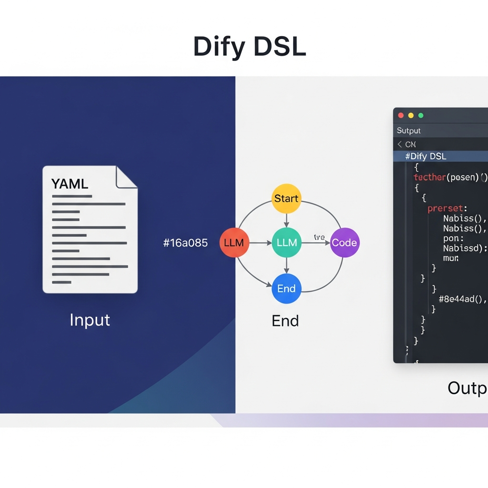
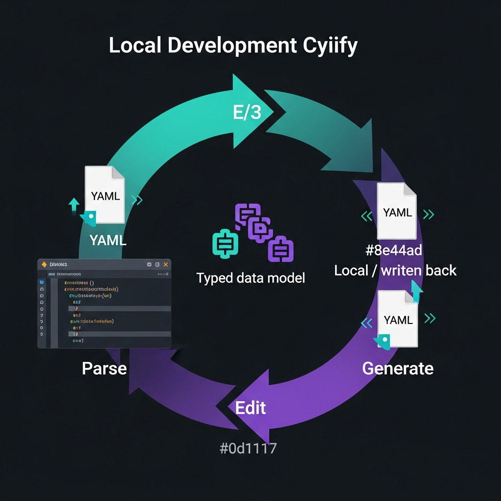
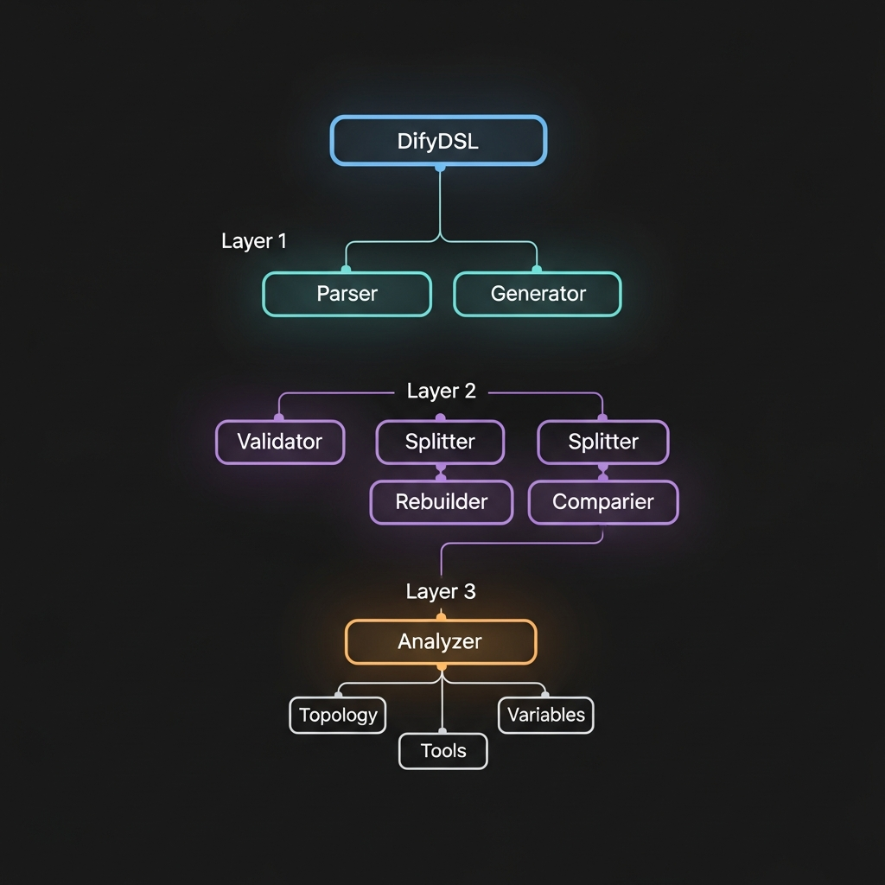

<p align="center">
  
</p>

<h1 align="center">Dify DSL Parser & Generator</h1>

<p align="center">
  <strong>在本地解析、编辑、优化 Dify 工作流，再生成回 DSL 导入 Dify</strong>
</p>

<p align="center">
  
  
  
  
</p>

---

## Why

Dify 的可视化编辑器适合快速搭建，但在需要**批量修改 prompt**、**代码审查工作流逻辑**、**跨工作流复用节点**时，GUI 效率低下。

本工具将 Dify DSL 解析为 **类型安全的 Python 对象**，支持在本地通过代码（vibe coding）编辑和优化工作流，再无损生成回 Dify 可导入的 YAML。

<p align="center">
  
</p>

## Features

| 能力 | 说明 |
|------|------|
| **类型安全解析** | 20+ 节点类型的 Pydantic 模型，自动验证，IDE 智能提示 |
| **无损往返** | `parse → generate` 保留全部字段，支持未知字段透传 |
| **工作流拆分** | 将 DSL 拆分为独立文件（prompt `.txt`、代码 `.py`），方便 Git 管理和 AI 辅助编辑 |
| **工作流重建** | 从拆分文件重建完整 DSL，直接导入 Dify |
| **拓扑分析** | 执行层级、死节点检测、可并行化分组 |
| **变量流追踪** | 静态分析 `{{#node.field#}}` 引用链，发现断裂引用 |
| **工具分析** | 统计 Tool/MCP/Agent 工具使用情况 |
| **结构对比** | 节点级 diff（增/删/改），不只是文本 diff |
| **DSL 验证** | 图结构、节点配置、循环依赖检测 |

## Architecture

<p align="center">
  
</p>

```
dify_dsl/
├── models/          # Pydantic 模型（DifyDSL, Node, 20+ 节点类型）
│   ├── dsl.py       # 顶层 DifyDSL 模型
│   ├── app.py       # App 元数据、依赖
│   ├── workflow.py  # Workflow、Graph、Edge
│   └── nodes.py     # 所有节点类型 + 注册工厂
├── parser.py        # YAML → 类型化模型
├── generator.py     # 类型化模型 → YAML
├── validator.py     # 结构 & 配置验证
├── splitter.py      # 拆分为可编辑文件
├── rebuilder.py     # 从拆分文件重建
├── comparator.py    # 结构 + 文本 diff
├── analyzer.py      # 拓扑、工具、变量流分析
└── cli.py           # 命令行入口
```

## Quick Start

### Installation

```bash
# 使用 uv（推荐）
uv venv --python 3.13 && source .venv/bin/activate
uv pip install -e ".[dev]"

# 或 pip
pip install -e ".[dev]"
```

### Python API

```python
from dify_dsl import parse_dsl, generate_dsl

# 解析 Dify DSL 文件
dsl = parse_dsl("workflow.yml")

# 查看工作流概要
print(dsl.summary())
# Dify DSL: 生产报错分析-v3
#   Mode: workflow
#   Nodes: 14
#   Edges: 15

# 访问类型化节点
for node in dsl.get_nodes_by_type("llm"):
    print(f"{node.data.title}: {len(node.data.prompt_template)} prompts")

# 修改 prompt
llm_node = dsl.get_nodes_by_type("llm")[0]
llm_node.data.prompt_template[0].text = "You are an expert error classifier..."

# 生成回 YAML
generate_dsl(dsl, "output.yml")
```

### CLI

```bash
# 解析并查看摘要
python -m dify_dsl parse workflow.yml

# 查看详细信息（节点列表、边关系）
python -m dify_dsl info workflow.yml

# 验证 DSL 结构
python -m dify_dsl validate workflow.yml

# 拆分为可编辑文件
python -m dify_dsl split workflow.yml -o my_workflow/

# 编辑后重建
python -m dify_dsl rebuild my_workflow/ -o rebuilt.yml

# 对比两个版本
python -m dify_dsl compare v1.yml v2.yml --html diff.html

# 分析工作流（拓扑 + 工具 + 变量流）
python -m dify_dsl analyze workflow.yml
```

## Usage Scenarios

### 1. 批量优化 LLM Prompt

```python
from dify_dsl import parse_dsl, generate_dsl

dsl = parse_dsl("workflow.yml")

for node in dsl.get_nodes_by_type("llm"):
    for prompt in node.data.prompt_template:
        if prompt.role == "system":
            # 统一添加输出格式约束
            prompt.text += "\n\n请严格按照 JSON 格式输出。"

generate_dsl(dsl, "workflow_optimized.yml")
```

### 2. 拆分后用 AI 编辑代码节点

```bash
# 拆分
python -m dify_dsl split workflow.yml -o my_workflow/

# 工作流被拆分为：
# my_workflow/nodes/code/01_node-xxx/code.py  ← 直接编辑 Python
# my_workflow/nodes/llm/01_node-yyy/system_prompt_1.txt  ← 直接编辑 prompt
# my_workflow/nodes/llm/01_node-yyy/user_prompt_2.txt

# 用你喜欢的编辑器或 AI 工具修改后重建
python -m dify_dsl rebuild my_workflow/ -o rebuilt.yml
```

### 3. 工作流质量分析

```python
from dify_dsl import parse_dsl
from dify_dsl.analyzer import analyze_topology, analyze_variable_flow

dsl = parse_dsl("workflow.yml")

# 检测死节点和不可达路径
topo = analyze_topology(dsl)
if topo.unreachable_nodes:
    print(f"Warning: unreachable nodes: {topo.unreachable_nodes}")
if topo.dead_end_nodes:
    print(f"Warning: dead-end nodes: {topo.dead_end_nodes}")

# 追踪变量引用
vf = analyze_variable_flow(dsl)
print(vf.summary)
```

### 4. 对比工作流版本差异

```python
from dify_dsl.comparator import compare_files

result = compare_files("v1.yml", "v2.yml")
print(result.summary)
# Nodes added: 2
#   + code/node-abc
#   + llm/node-def
# Nodes modified: 1
#   ~ llm/node-123: changed fields: prompt_template
```

## Supported Node Types

| 分类 | 节点类型 |
|------|----------|
| **基础** | `start`, `end`, `answer` |
| **数据处理** | `llm`, `code`, `template_transform`, `variable_aggregator`, `variable_assigner`, `knowledge_retrieval` |
| **逻辑控制** | `if_else`, `iteration`, `iteration_start`, `loop` |
| **外部集成** | `http_request`, `tool`, `agent`, `question_classifier`, `mcp_server` |
| **触发器** | `trigger_webhook`, `trigger_schedule`, `trigger_plugin` |
| **工具** | `parameter_extractor`, `list_filter`, `doc_extractor` |

> 未知节点类型会自动降级为通用 `NodeData`（`extra="allow"`），所有字段仍会保留。

## Development

```bash
# 运行测试
python -m pytest tests/ -v

# 测试覆盖真实 DSL 文件的解析、验证、拆分重建、往返一致性
```

## Tech Stack

- **Python 3.11+**
- **Pydantic v2** — 类型安全的数据模型，自动验证
- **ruamel.yaml** — 格式保留的 YAML 解析/生成（降级到 PyYAML）
- **pytest** — 测试框架

## License

MIT

## Python ↔ Dify DSL 无损双向同步

支持把 Dify Workflow YAML 转成**声明式 Python 数据文件**，反向生成 YAML，或持续监听两侧更改。转换过程保留原始 DSL 中的节点数据、Code/LLM Prompt、变量、连线、未知扩展字段和显式设置的元数据；不会执行 Python 文件中的任意代码。

```bash
# 首次将 Dify Workflow 转成可编辑的 Python 数据声明
uv run dify-dsl to-python workflow.yml -o workflow.py

# Python 修改后生成新 DSL（默认禁止覆盖已有文件）
uv run dify-dsl from-python workflow.py -o rebuilt.yml

# 为一对文件建立同步状态；之后自动识别哪侧发生修改
uv run dify-dsl sync workflow.yml workflow.py

# 可选：前台持续监听；Ctrl+C 停止
uv run dify-dsl sync workflow.yml workflow.py --watch --interval 1
```

`workflow.py` 包含一个可直接编辑的 `WORKFLOW_DSL = {...}` 字典，与其他 Python 代码不同：这个转换器不会分析任意 Python 程序的控制流，也不支持自动把业务脚本拆成 Dify 节点。首次同步要求两边语义一致，或者其中一边不存在；检测到两边都修改且内容冲突时会停止，不会自动覆盖。`.sync.json` 记录语义内容指纹。必要时使用 `to-python --force` / `from-python --force` 明确覆盖指定文件，避免误覆盖已有工作流。

注意：无损往返测试只保证**配置数据保真**，不能保证未来全部 Dify 节点在目标实例上可执行；节点所依赖的插件、凭证和 Dify 版本仍需逐项进行运行验证。
